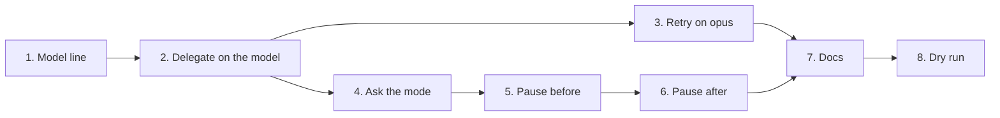

# Plan: two implement modes (code-auto, code-journey)

## Source spec
`docs/specs/2026-10-23-implement-modes.md`

## Critical files
- `skills/plan-from-spec/SKILL.md` — every step gets a `Model:` line.
- `skills/implement/SKILL.md` — a short "Modes" section: the mode
  question, delegation, the retry rule, and the two code-journey pauses.
  The existing per-step loop stays; delegation slots into its "write the
  code" part.
- `evals/<case>/case.yaml` (+ `scaffold.sh` where the case needs a repo) —
  one new case per behaviour. Pattern: the scaffold builds a tiny Python
  repo holding an approved spec and plan (see `evals/implement-ad-hoc/` for
  the shape); the prompt starts `implement`; `regex` and `llm` graders read
  the trace.
- `docs/engineering/implement.md`, `docs/engineering/plan-from-spec.md` —
  describe both modes; code-journey marked draft.

Reuse: `evals/implement-ad-hoc/scaffold.sh` as the base for every scaffold;
`evals/plan-traces-criteria/` for SC-1 instead of a new case (see step 1).

How each step is test-first here: write the eval case, run it once
(`--runs 1`) and watch it fail on the current skill text, then change the
skill, then run the full check (3 runs).

## Order

## Steps

### 1. Give every plan step a `Model:` line
- Status: blocked — eval not run (the eval child can't sign in on this host)
- Depends on: none
- Touches: `skills/plan-from-spec/SKILL.md`, `evals/plan-traces-criteria/case.yaml`
- Size: S
- Satisfies: SC-1
- Verification: `claude plugin eval . --no-publish --model sonnet --case plan-traces-criteria` → ≥ 67%, with a new `regex` grader on `Model: (sonnet|opus) \(.+\)` and an `llm` bullet that the risky shared-schema step gets `opus`.
- Note: this adds graders to the existing case rather than a new `plan-models` case. One case to maintain, not two. The spec's SC-1 check names `plan-models`; it changes to `plan-traces-criteria` on your yes.

### 2. Hand each plan step's coding to a subagent on the step's model (code-auto)
- Status: todo
- Depends on: step 1
- Touches: `skills/implement/SKILL.md`, `evals/implement-code-auto/{case.yaml,scaffold.sh}`
- Size: M
- Satisfies: SC-3
- Verification: `claude plugin eval . --no-publish --model sonnet --case implement-code-auto --scaffold --allow-tools Write Edit Bash` → ≥ 67%. The scaffold's plan has one `sonnet` step and one `opus` step; the prompt says "code-auto".
- Also in this step: the OpenCode line (one model, said once) and the one-line deviation from agent-skills. Riskiest step: it is the first to show whether this Mac's eval sandbox runs Bash and whether the trace shows the Agent call's `model`. If either fails, stop and decide before step 3.

### 3. Retry a failing step on opus, stop after 2 opus failures
- Status: todo
- Depends on: step 2
- Touches: `skills/implement/SKILL.md`, `evals/implement-escalates/{case.yaml,scaffold.sh}`
- Size: S
- Satisfies: SC-4
- Verification: `claude plugin eval . --no-publish --model sonnet --case implement-escalates --scaffold --allow-tools Write Edit Bash` → ≥ 67%. The scaffold's step checks for a value the code can't produce.

**Checkpoint:** `python3 scripts/validate.py`, `python3 scripts/test_validate.py`, `python3 scripts/test_floor_guard.py` all green; you read the code-auto text before code-journey builds on it.

### 4. Ask "code-auto or code-journey?" after the plan's yes
- Status: todo
- Depends on: step 2
- Touches: `skills/implement/SKILL.md`, `evals/implement-asks-mode/{case.yaml,scaffold.sh}`
- Size: S
- Satisfies: SC-2
- Verification: `claude plugin eval . --no-publish --model sonnet --case implement-asks-mode --scaffold --allow-tools Write Edit` → ≥ 67%.

### 5. code-journey: write the unit file, then pause before any code
- Status: todo
- Depends on: step 4
- Touches: `skills/implement/SKILL.md`, `evals/journey-pause-before/{case.yaml,scaffold.sh}`
- Size: S
- Satisfies: SC-5
- Verification: `claude plugin eval . --no-publish --model sonnet --case journey-pause-before --scaffold --allow-tools Write Edit` → ≥ 67%.

### 6. code-journey: add "What changed", pause, and commit the unit file with the code
- Status: todo
- Depends on: step 5
- Touches: `skills/implement/SKILL.md`, `evals/journey-what-changed/{case.yaml,scaffold.sh}`
- Size: S
- Satisfies: SC-6
- Verification: `claude plugin eval . --no-publish --model sonnet --case journey-what-changed --scaffold --allow-tools Write Edit Bash` → ≥ 67%. The scaffold already holds unit 1's file; the prompt says "go".

**Checkpoint:** the three suites from step 3's checkpoint green; `wc -l skills/implement/SKILL.md` — if the Modes section pushed it past ~200 lines, say so before step 7.

### 7. Describe both modes in the docs
- Status: todo
- Depends on: steps 3, 6
- Touches: `docs/engineering/implement.md`, `docs/engineering/plan-from-spec.md`, `evals/README.md`, `CHANGELOG.md`, `.claude-plugin/plugin.json`
- Size: S
- Satisfies: SC-7
- Verification: `python3 scripts/validate.py` → `All checks passed`; `rg -c "code-auto|code-journey" docs/engineering/implement.md docs/engineering/plan-from-spec.md` → ≥ 1 each; `rg -n -i "\bauto mode\b" skills/implement` → no matches.
- The eval table, CHANGELOG entry and version bump (2.0.2 → 2.1.0, a new feature) aren't in any SC. They are repo rules (`CLAUDE.md` Versioning; `evals/README.md` lists every case), so they ride in this step rather than getting their own.

### 8. Dry-run code-journey on a real task
- Status: todo
- Depends on: step 7
- Touches: `docs/specs/2026-10-23-implement-modes.md` (adds `## Dry run`)
- Size: S
- Satisfies: SC-8
- Verification: `rg -c ': understood$' docs/specs/2026-10-23-implement-modes.md` → ≥ 2.
- Needs a real task you pick, run by an engineer with the plugin loaded from this branch. Until it passes, code-journey stays draft.
