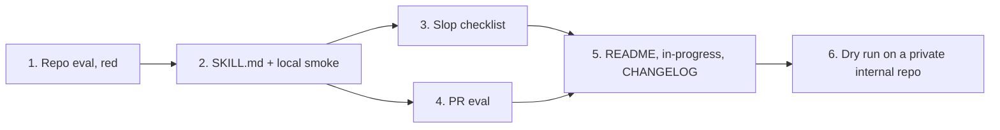

# Plan: code-audit

## Source spec
`docs/specs/2026-11-02-code-audit.md`

## Critical files
- `evals/code-audit-repo/case.yaml`, `scaffold.sh` — new; a small repo with planted problems and one decoy, graded for findings, lens models and no edits.
- `skills/code-audit/SKILL.md` — new; scope, Map step, model rule, the 3 lens briefs, the verify pass, the report shape.
- `skills/code-audit/references/slop-checklist.md` — new; AI-slop patterns `engineering-standards` doesn't already name. Lens 2's brief points at it.
- `evals/code-audit-pr/case.yaml`, `scaffold.sh` — new; a git repo whose branch breaks a caller outside the diff.
- `README.md`, `docs/in-progress.md`, `CHANGELOG.md`, `evals/README.md` — the ponytail paragraph rewritten with credit; draft tracking; the Unreleased entry; the eval table.

New skill directory, not an addition to `review-code`: the concern is
new (whole-scope audit, no gate), and folding it into `review-code`
would give one skill two verdicts. No version bump: entries go under
`## Unreleased` in `CHANGELOG.md`, so this branch and PR #10 (which
claims 2.1.0) don't fight over a number.

Reuse, don't restate: Lens 1 cites `review-code` Steps 4-5 and
`engineering-standards` (Error handling, Security, Testing); Lens 2 cites
`engineering-standards` (Necessity and simplicity, DRY, SOLID); Lens 3
calls `codebase-architecture`. The finding shape and check-before-report
rules adapt `ponytail-audit` (MIT).

## Order

## Steps

### 1. Build the planted-problem repo eval
- Status: blocked — eval not run (runs on the user's other machine); scaffold built and checked locally
- Depends on: none
- Touches: `evals/code-audit-repo/case.yaml`, `evals/code-audit-repo/scaffold.sh`
- Size: S
- Satisfies: SC-2, SC-3, SC-5
- Verification: `d=$(mktemp -d) && (cd "$d" && bash /Users/girijesh.prasad/Documents/sde-code-audit/evals/code-audit-repo/scaffold.sh && python3 -m unittest -q)` → scaffold builds and its tests pass, so the planted problems hide behind a green suite. The eval itself (`claude plugin eval . --no-publish --model sonnet --case code-audit-repo --scaffold --allow-tools Write Edit Bash` → ≥ 67%) runs on the user's other machine; until then this step's eval part is `blocked — eval not run`.
- Plants: (a) `except: pass` around a database write; (b) a one-implementation interface that only forwards calls; (c) a lower-layer module importing a higher one; (d) decoy: a handler looked up by its name as a string; (e) `json.dumps(obj, sort=True)` (invented keyword; real one is `sort_keys`) on an error path no test runs. Graders: `code-audit` fired; Agent called 3 times; `lens-1-on-opus` (`"model"\s*:\s*"opus"`); `lens-models-printed`; llm grader for (a)-(e) and the 4-part shape; a trace grader for 3 lens calls and read-only (no Edit/Write, no file-changing Bash).
- Riskiest step first: if a planted problem can't be made realistic in ~150 lines, the spec's SC-2 is wrong and we learn it before writing the skill.

### 2. Write the code-audit skill
- Status: todo
- Depends on: step 1
- Touches: `skills/code-audit/SKILL.md`
- Size: M
- Satisfies: SC-1, SC-8
- Verification: `python3 scripts/validate.py` → `All checks passed`; `wc -l < skills/code-audit/SKILL.md` → ≤ 200. Local smoke (not the eval, a stand-in while the eval is blocked): scaffold step 1's repo into a temp dir, start a fresh subagent told to read `skills/code-audit/SKILL.md` and follow it on that dir, and check by reading its report that it names (a)-(c), skips (d), and the temp dir's `git status --porcelain` is empty.
- If the lens briefs push past 200 lines, they move to `references/lenses.md` in this step.

### 3. Write the AI-slop checklist
- Status: todo
- Depends on: step 2
- Touches: `skills/code-audit/references/slop-checklist.md`, `skills/code-audit/SKILL.md` (Lens 2's pointer)
- Size: S
- Satisfies: SC-2 (planted item e)
- Verification: `rg -c "slop-checklist" skills/code-audit/SKILL.md` → ≥ 1; re-run step 2's local smoke → the report also names (e).
- Each entry is one pattern, one line on why it hurts, and how to spot it. No entry repeats a rule `engineering-standards` already states; the step's review checks that by reading both side by side.

**Checkpoint:** `python3 scripts/validate.py` and `python3 -m unittest discover -s scripts -q` green; human look at the skill and the local smoke report before the PR eval and docs.

### 4. Build the PR-mode eval
- Status: todo
- Depends on: step 2
- Touches: `evals/code-audit-pr/case.yaml`, `evals/code-audit-pr/scaffold.sh`
- Size: S
- Satisfies: SC-4, SC-5
- Verification: `d=$(mktemp -d) && (cd "$d" && bash /Users/girijesh.prasad/Documents/sde-code-audit/evals/code-audit-pr/scaffold.sh && git log --oneline main..feature)` → one commit on `feature` changing a function's return type, with the broken caller in a file that commit doesn't touch. Local smoke as in step 2, on branch `feature` → the report names the broken caller and has no READY / NEEDS FIXES and no spec section. The eval (`... --case code-audit-pr ...` → ≥ 67%) is `blocked — eval not run` until the other machine runs it.

### 5. Track it as draft and update the README
- Status: todo
- Depends on: steps 3, 4
- Touches: `README.md`, `docs/in-progress.md`, `CHANGELOG.md`, `evals/README.md`
- Size: S
- Satisfies: SC-6, SC-7
- Verification: `rg -c "What isn't\s*$" README.md` → no match; `rg -c "code-audit.*ponytail|ponytail.*code-audit" README.md` → ≥ 1; `rg -c "ponytail.*MIT|MIT.*ponytail" README.md` → ≥ 1; `rg -c "code-audit" docs/in-progress.md` → ≥ 1; `test ! -e docs/engineering/code-audit.md && echo ok` → `ok`; `python3 scripts/validate.py` → `All checks passed`.
- The CHANGELOG `## Unreleased` entry and the two `evals/README.md` table rows aren't in any SC. They're repo rules (`evals/README.md` lists every case; changes are logged), so they ride in this step.

**Checkpoint:** push `feat/code-audit`, open a draft PR; the user runs the two evals on the other machine.

### 6. Dry-run code-audit on a private internal repo
- Status: todo
- Depends on: step 5
- Touches: `docs/specs/2026-11-02-code-audit.md` (adds `## Dry run`)
- Size: S
- Satisfies: SC-9
- Verification: `rg -c '^- Finding [0-9]+: real' docs/specs/2026-11-02-code-audit.md` ÷ `rg -c '^- Finding [0-9]+:' docs/specs/2026-11-02-code-audit.md` → ≥ 0.67, second count ≥ 3.
- Run by the user in a clone of a private internal repo (not named here: this repo is public), with the plugin installed from this worktree (`claude plugin marketplace add /Users/girijesh.prasad/Documents/sde-code-audit`). The user marks each finding. Until it passes, code-audit stays draft.
