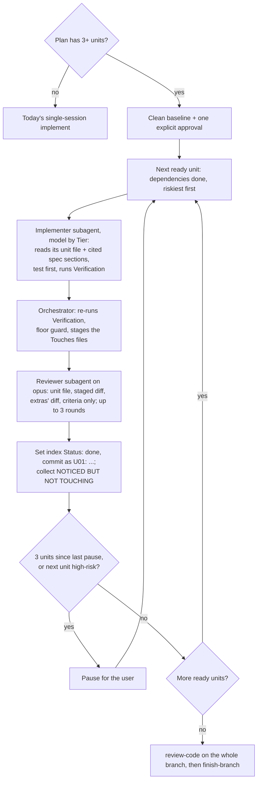

# Sequential dispatch: plan → units → one fresh agent per unit

## Context

Today `implement` runs a whole plan in one session with one model. On a
long plan, the context grows with every step, so later steps work with a
crowded context, and easy steps run on the same model as hard ones.

This spec turns each plan step into a **unit**: a step written so that a
fresh agent, without the conversation that wrote the plan, can build it
from its own file. `implement` then runs the units one at a time, each in a
new subagent on a model picked by how hard the unit is.

The idea and its rules come from
[`research/2026-10-12-tickets-and-parallel-implement.md`](../../research/2026-10-12-tickets-and-parallel-implement.md).
Its five open decisions, and four more, were settled in a `grill-me`
session on 2026-10-19. All three prerequisites landed in 2.0.0:

- the floor guard (`d4aa33c`): a script that flags changes that weaken
  tests or checks;
- NOTICED BUT NOT TOUCHING (`42edd5c`): a list `implement` keeps of
  problems it saw but deliberately left alone;
- numbered success criteria, `SC-n` (`3793d64`).

## Goals

1. `plan-from-spec` writes a plan index plus one unit file per step,
   when the plan has 3 or more steps. Each field lives in one place only.
2. `implement` switches to dispatch mode automatically for a plan with 3
   or more units, and runs them one at a time, each in a fresh subagent.
3. On Claude Code, each unit runs on `sonnet` (tiers S and M) or `opus`
   (tier L). A tier is how hard the unit is, set in the plan. Reviewers
   always run on `opus`.
4. On OpenCode, the same loop runs with two implementer agent definitions,
   "standard" and "strong", whose models the user sets.
5. One real 5–8 unit plan is run in both modes, and the token, time, and
   rework numbers are recorded.

## Non-Goals

- Parallel worktrees — wall-clock speed is not the bottleneck; approvals
  and review are. Revisit only if the SC-9 numbers show time is a real cost.
- A separate test-writer agent for tier-L units — the floor guard, the
  mutation spot-check (the reviewer breaks the code and checks the test
  goes red), and the diff-only reviewer already catch a bent test. Add it
  if the dry run shows a bent test getting through on an L unit.
- `haiku` as a tier — the user chose `sonnet` and `opus` only.
- Units as GitHub issues — files work offline, in OpenCode, and need no
  permissions.
- A PR per unit — many criteria pass only once several units land, and
  `finish-branch` checks every criterion on the whole set.
- A new skill (like mattpocock's `implement-spec`) — the spine stays five
  links; this is a mode of `implement`.
- Tempting cuts, none needed at this scale: a unit database or JSON state
  file, a dashboard of unit progress, per-unit cost tracking inside the
  run, a config option for the 3-unit threshold.

## Assumptions

ASSUMPTIONS I'M MAKING:
- Scale: plans of 3–8 steps, one engineer running one plan at a time.
  Lifetime: long-lived.
- The plan's existing step fields (`Status`, `Depends on`, `Touches`,
  `Size`, `Satisfies`, `Verification`) and checkpoints stay as they are
  in `plan-from-spec` 2.0.1 for plans of 1–2 steps. In a units index,
  `Status` is `todo`, `done`, or `blocked <reason>`, with no SHA, and
  `Risk` is `high` or `normal`.
- Claude Code's Agent tool takes the aliases `sonnet` and `opus`, so no
  model IDs are hard-coded.
- OpenCode (1.18.10, from `opencode --version`) sets a subagent's model
  in its agent definition (`model: provider/model-id`), not per call: the
  Task tool takes no `model` parameter
  ([`tool/task.ts:44-58`](https://github.com/anomalyco/opencode/blob/v1.18.10/packages/opencode/src/tool/task.ts#L44-L58)).
  With no `model` set, the subagent runs on the caller's model
  ([`tool/task.ts:181`](https://github.com/anomalyco/opencode/blob/v1.18.10/packages/opencode/src/tool/task.ts#L181)).
  Project agent files go in `.opencode/agents/` (`.opencode/agent/` also loads,
  [`config/agent.ts:13`](https://github.com/anomalyco/opencode/blob/v1.18.10/packages/opencode/src/config/agent.ts#L13)).
- SC-3, SC-4a, SC-4b and SC-5 run on a host where Bash works inside the
  eval sandbox (it did not on the RHEL 8 host in `evals/README.md`).

## Boundaries

- Always: the orchestrator (the agent running the loop) re-runs each
  unit's Verification itself; an implementer's "tests pass" is a claim,
  not evidence.
- Always: stage only the unit's files (its `Touches`, plus any extras the
  reviewer approved) and its index row; one commit per
  unit, its message starting with the unit ID (`U01: …`); the code builds
  at every commit.
- Ask first: before starting the run (one explicit approval of the units),
  at every pause, and whenever a stop condition is hit. A request that
  names the plan file and says the units are approved counts as the
  approval. A bare "go ahead" doesn't. Approval never skips a pause.
- Never: an implementer edits a unit's test to make it pass by weakening
  it; implementers or reviewers start agents of their own (depth 1).

## Approach

**Artifacts (option C, chosen over a plan-only and a full-copy design).**
The plan file becomes an index; each unit file holds the detail. No field
appears in both, so they can't drift apart.

| Lives in the plan index | Lives in the unit file |
|---|---|
| Unit ID, `Status`, `Depends on`, `Satisfies`, `Tier`, `Risk` | Plain step name, `Touches` (predicted), `Size`, `Verification`, `Context` |

- Plan: `docs/plans/YYYY-MM-DD-<topic>.md`, with a `## Units` table.
- Units: `docs/plans/YYYY-MM-DD-<topic>/units/NN-<slug>.md`.
- `Size` (XS–L; XL must be split) is how much work. `Tier` (S/M/L) is how
  hard: scored on ambiguity, blast radius, novelty, risk, and test
  difficulty. They are scored separately.
- `Context` names the spec sections to read, the existing code pattern to
  copy, and gotchas found while planning.
- Plans with 1–2 steps keep today's format, with no units folder.

Alternatives: **A, plan only** (add Tier/Risk/Context to plan steps) was
smallest, but gives a cold agent the whole plan and little room for
per-unit context. **B, full copy in unit files** (the research
proposal's sketch) gives focus, but repeats Status and criteria in two
places.

**The loop**, in `implement`, with its mechanics in
`implement/references/dispatch.md`:

Rules on the loop:
- **Escalation:** a failure is one implementer attempt whose
  Verification fails when the orchestrator re-runs it. Two failures on
  `sonnet` re-run the unit on `opus`, with the failure notes. Two failures
  on `opus` stop the run and ask the user.
- **Other stops:** the spec turns out to be ambiguous, or a change can't be
  undone with `git revert`.
- **Files outside `Touches`:** the implementer lists them. The reviewer
  sees their diff next to the staged one. The orchestrator stages them
  only if the reviewer agrees the unit's criteria need them; otherwise
  they are reverted and go under NOTICED BUT NOT TOUCHING.
- **Resume:** run `implement` again; it continues from the index's
  `Status` column. `git log --grep '^U01'` finds a unit's commit.
- **Naming calls:** each implementer call's description starts with
  `Implement U<NN>` and each reviewer call's with `Review U<NN>`. Every
  call names its `model`, even when it matches the caller's. Logs and
  evals tell the calls apart by these.
- **No Write tool:** `plan-from-spec` prints the index and every unit
  file in its reply instead of asking how to proceed.
- **Landing:** one branch, one PR, through `finish-branch`.
- **OpenCode:** the orchestrator calls `sde-implementer-standard` for S/M
  units and `sde-implementer-strong` for L units and reviews. With no
  model set on either, both inherit the main model and the run is
  single-model; `implement` says so at the start.

## Testing Seams

- **Plugin evals** (`claude plugin eval`), one case per behaviour: the
  highest seam that sees what a user sees (which skill fired, which
  subagents ran on which model, what was committed).
- **`scripts/validate.py`** and its tests for structure.
- **One real dry run** (SC-9) for the cost comparison, which no eval can
  give.

## Success Criteria & Evals

Each eval case runs 3 times. A run passes when every scored grader in it
passes. The result is the report's `PASS%` column (runs scoring 1.0 ÷
runs), so "≥2 of 3" means `PASS%` ≥ 67%. The exit code is not the result:
with 2 of 3 runs passing it still exits 1 under the default
`--threshold 1.0`. SC-2's case exists; the plan writes the cases for
SC-1, SC-3, SC-4a, SC-4b and SC-5. Graders read a file's contents with a
`{source: file, path}` target and bound call counts with `tool_used`'s
`min`/`max`. `--ablation none` skips the no-plugin comparison run,
which means nothing for these behaviours. Runs are non-interactive and end
at the first question. Planning cases' prompts say the spec is approved;
dispatch cases' prompts name the plan file and say the units are
approved. Scaffolds start with a passing test suite. Turn
and time limits, and the exact grader patterns, are set in the plan.

- **SC-1:** Given a spec whose Approach names 4 separate changes, one per
  criterion, `plan-from-spec` writes an index with the columns Unit,
  Status, Depends on, Satisfies, Tier, Risk, and at least 3 files under
  `units/` (the `01-`, `02-` and `03-` files exist). No `Write` to a
  unit file contains `Status`, `Depends on`, `Satisfies`, `Tier` or
  `Risk` as a label in any form: a `Field:` line, a table cell, or a
  heading. Check:
  `claude plugin eval . --no-publish --model sonnet --ablation none --case plan-emits-units --allow-tools Write`
  → PASS in ≥2 of 3 runs.
- **SC-2:** Planning doesn't regress. The existing case runs unchanged,
  with the same tool grant as its 2026-10-12 reading (no `Write`), so the
  plan appears in the final message. SC-1 covers the unit files. Check:
  `claude plugin eval . --no-publish --model sonnet --ablation none --case plan-traces-criteria`
  → PASS in ≥2 of 3 runs.
- **SC-3:** A 2-step plan runs in a single session: `implement` fires,
  each step lands as a commit, no `Agent` call's description starts with
  `Implement U`, and no `units/` folder is written. Check:
  `claude plugin eval . --no-publish --model sonnet --ablation none --case implement-small-plan --scaffold --allow-tools Write Edit Bash`
  → PASS in ≥2 of 3 runs (the existing `implement-ad-hoc` case fired in
  4 of 6 runs, so 3 of 3 would fail on trigger noise).
- **SC-4a:** Given an approved 3-unit plan with tiers S, M, L and no
  high-risk unit, every unit gets an implementer `Agent` call. The first
  call for the S and M units asks for `sonnet`; every call for the L unit
  and every reviewer call asks for `opus`. Each unit lands as one commit
  starting with its unit ID, and the index shows all 3 units `done`.
  Check:
  `claude plugin eval . --no-publish --model sonnet --ablation none --case implement-dispatch --scaffold --allow-tools Write Edit Bash`
  → PASS in ≥2 of 3 runs.
- **SC-4b:** Given an approved 4-unit plan where unit 2 is high-risk and
  depends on unit 1, and units 3 and 4 depend on unit 2, the run commits
  unit 1, then stops with a pause that names unit 2, and makes no
  implementer `Agent` call for unit 2. The pause message says unit 2 is
  high-risk. Check:
  `claude plugin eval . --no-publish --model sonnet --ablation none --case dispatch-pause --scaffold --allow-tools Write Edit Bash`
  → PASS in ≥2 of 3 runs.
- **SC-5:** Given an approved 3-unit plan whose unit 1 (tier S) has a
  Verification that can't pass (the suite starts green; the unit's test
  asserts what an existing passing test rules out), the run makes exactly
  2 `Implement U01` calls on `sonnet` and 1–2 on `opus`, the first
  `sonnet` call before the first `opus` call. It makes no `Write` or
  `Edit` to the scaffold's test file, and its final message names U01 and
  asks the user. Check:
  `claude plugin eval . --no-publish --model sonnet --ablation none --case dispatch-escalation --scaffold --allow-tools Write Edit Bash`
  → PASS in ≥2 of 3 runs.
- **SC-6:** The repo still validates. Check: `python3 scripts/validate.py`
  → `All checks passed.`; `python3 scripts/test_validate.py` and
  `python3 scripts/test_floor_guard.py` → `OK`.
- **SC-7:** `implement/SKILL.md` stays scannable. Check:
  `wc -l < skills/implement/SKILL.md` → 150 or less, and
  `test -f skills/implement/references/dispatch.md` → exit 0.
- **SC-8:** OpenCode ships `sde-implementer-standard` and
  `sde-implementer-strong` agent definitions with no model hard-coded, and
  `OPENCODE.md` says how to set them. Check: `rg -c '^model:'` on both
  files → no matches; `rg -n 'sde-implementer-strong' OPENCODE.md` → at
  least 1 match.
- **SC-9:** One real 5–8 unit plan runs in both modes, and
  `docs/in-progress.md` records tokens, wall time, rework, escalations, and
  floor-guard hits for each. Check:
  `rg -n 'sequential dispatch' docs/in-progress.md` → a row with all 5
  numbers for both modes.

## Open Questions

None. The `--allow-tools Agent` question is closed: the eval harness
always grants `Agent` (Claude Code 2.1.303), so the commands don't pass it.
