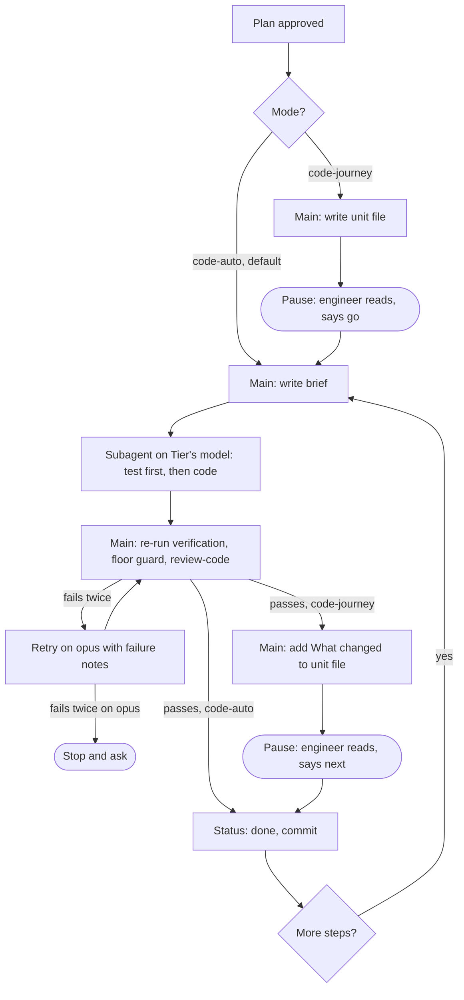

# Two implement modes: code-auto and code-journey

## Context

Engineers coding alongside Claude Code lose track of the work. Specs, plans
and code arrive fast, in dense technical language, and the engineer ends up
approving changes they haven't followed. The team suggested two ways to run
`implement` after `plan-from-spec`:

- **code-auto** (the default): code the plan step by step, as today.
- **code-journey**: before each step, write a plain explanation the engineer
  reads first. After the step, write a plain note on what changed.

Both modes hand each step's coding to a subagent on a model picked for that
step: `sonnet` for routine work, `opus` for hard or risky work.

The names avoid "auto" alone. Claude Code has an Auto Mode (a permission
mode), and `grill-me` already refers to it.

Inputs: `research/2026-10-12-tickets-and-parallel-implement.md`, Section C
of the addendum in `research/2026-10-12-upstream-findings.md` (lines
559-581), and PR #8's spec and grill-me log (closed, head `3774957`).

## Goals

- After the engineer says yes to the plan, `implement` asks which mode to
  use. code-auto is preselected.
- In code-journey, the engineer reads a plain write-up of each step before
  any code for it is written, and a plain "What changed" note before it is
  committed.
- `plan-from-spec` gives every step a tier (S, M or L) and the model that
  tier maps to, with a one-line reason. The engineer can change it when
  approving the plan.
- In both modes, each step's coding runs in a subagent on the tier's model.
- After 2 failed checks, a step is retried on `opus`. After 2 failures on
  `opus`, the run stops and asks the engineer.

## Non-Goals

- Parallel steps or git worktrees: PR #8 was closed over this complexity;
  one engineer follows one step at a time.
- `haiku` as a tier: no step in this repo's plans is mechanical enough to
  trust it with code, and a third tier is more to explain.
- A separate test-writer subagent: the implementer writes test then code,
  as `test-driven-development` already says.
- Units as GitHub issues: the unit files in the repo are enough for one
  engineer.
- A new skill: the modes live inside `implement`'s per-step loop, which
  CLAUDE.md says to extend rather than duplicate.
- A config option to skip the mode question: one question per plan costs
  little, and a hidden default is how the engineer loses track.
- Unit files in code-auto: code-auto's plan stays as it is today, plus the
  `Tier` line.

## Assumptions

ASSUMPTIONS I'M MAKING:

- Scale: plans of 1-10 steps, one engineer per branch. Lifetime: long-lived.
- The Agent tool's `model` parameter accepts `sonnet` and `opus`. It does
  today (`sonnet`, `opus`, `haiku`, `fable`).
- Subagents can't start subagents, so review, floor guard, verification and
  commit stay in the main session (addendum Section C).
- An ad-hoc change with no plan has no tier, so `implement` codes it in the
  main session, as today. "Delegate every step" applies to plan steps.
- OpenCode has no per-call model choice. There, `implement` says so once
  and codes every step on the session's model.
- A "failed check" is the main session's re-run of the step's verification
  command failing, or `review-code` returning NEEDS FIXES.

## Boundaries

- Always: the main session re-runs the step's verification itself; the
  subagent's "tests pass" is a claim, not evidence.
- Always: each delegation call names `model` explicitly.
- Always (code-journey): end the turn at each pause. Wait for the
  engineer's reply.
- Ask first: switching mode partway through a plan.
- Ask first: going past 2 failures on `opus`.
- Never: let the implementer subagent run `review-code`, the floor guard, a
  commit, or another subagent.
- Never: edit a source file in code-journey before the engineer has said
  go on that step's unit file.

## Approach

**Recommended: extend `implement` and `plan-from-spec`.** No new skill.

`plan-from-spec` adds one line to every step:
`Tier: <S|M|L> → <model> (<reason>)`. Tier is scored from size, complexity
and blast radius (how much breaks if the step is wrong). S and M map to
`sonnet`; L maps to `opus`. `Size` stays as it is: it measures how much
work, and `Tier` measures how hard.

After the plan's explicit yes, `implement` asks: "code-auto or
code-journey?", with code-auto preselected. Then, per step:

- **Brief:** the step text, the spec lines it cites, the files to touch, the
  pattern to follow and known gotchas. The subagent returns a short report:
  files changed, test run output, anything noticed but not touched.
- **Unit file** (code-journey): `docs/plans/<date>-<topic>/units/NN-<slug>.md`.
  At the top, a 3-5 line `simple`-style picture of what this step does and
  why. Below it, a `plain-technical-writing` body: what changes, why, which
  files, and how we'll know it works (the step's verification command).
- **What changed note** (code-journey): appended to the unit file. It covers
  what the code now does, in plain words, quoting the 2-5 diff lines that
  matter, and the verification result.
- **Commit:** code, plan status line, and in code-journey the unit file, in
  one commit per step.
- **Checkpoints** in code-auto stay as the plan sets them (every 2-3 steps).
  In code-journey each step already pauses twice.
- **Mechanics** go in `skills/implement/references/delegation.md`: brief
  shape, tier table, escalation rule, and the wording of both pauses.
  `implement/SKILL.md` gets a short "Modes" section that points there.
- **Upstream deviation:** addyosmani/agent-skills says model choice
  "belongs to the harness". `implement` says in one line that this plugin
  chooses per step, and why: to cut cost on routine steps.

**Minimal alternative:** code-journey as a `dev-workflow` route that chains
existing skills, with no change to `implement`. Rejected: the pauses, unit
files and per-step model all sit inside `implement`'s step loop, and a
route outside that loop can't reach them. Goal 2 (read before code, read
before commit) needs a hook inside each step.

## Testing Seams

- **Plugin evals** (`claude plugin eval`, one case per behaviour, under
  `evals/`). They watch the whole trace: Agent calls and their `model`,
  Skill calls, file edits, and the final message. This is the highest seam
  that sees the behaviour. It catches skipped pauses, missing `model`
  parameters and review run in the wrong place. It misses whether the plain
  write-ups are actually easy to read; an `llm` grader covers that only
  roughly.
- **`scripts/validate.py`** for skill structure and docs.
- Cases that run tests need `--scaffold --allow-tools Write Edit Bash`, and
  Bash needs a working OS sandbox (see `evals/README.md`). Where the sandbox
  fails, their trigger graders still count; outcome graders are reported as
  "not run".

## Success Criteria & Evals

Each eval runs 3 times (the default). "Pass" means every grader in the
case passes in at least 2 of 3 runs (≥ 67%).

- **SC-1:** `plan-from-spec` gives every step a line matching
  `Tier: (S|M|L) → (sonnet|opus) \(.+\)`, and every L step maps to `opus`.
  Check: `claude plugin eval . --no-publish --model sonnet --case plan-tiers`
  → ≥ 67%.
- **SC-2:** after the plan's yes, `implement` asks for code-auto or
  code-journey, code-auto preselected, before any Edit or Write to a source
  file. Check: `claude plugin eval . --no-publish --model sonnet --case
  implement-asks-mode --scaffold --allow-tools Write Edit Bash` → ≥ 67%.
- **SC-3 (code-auto):** every implementer Agent call names `model` matching
  its step's tier. The verification re-run, `review-code` and `git commit`
  appear in the main trace after each Agent call returns. Check: `claude
  plugin eval . --no-publish --model sonnet --case implement-code-auto
  --scaffold --allow-tools Write Edit Bash` → ≥ 67%.
- **SC-4 (escalation):** the scaffold holds a step whose verification can't
  pass. The trace shows 2 Agent calls with `model: sonnet`, then 2 with
  `model: opus`, then a final message that stops and asks; there is no fifth
  Agent call and no commit. Check: `claude plugin eval . --no-publish
  --model sonnet --case implement-escalates --scaffold --allow-tools Write
  Edit Bash` → ≥ 67%.
- **SC-5 (code-journey, before):** the first turn creates
  `docs/plans/*/units/01-*.md` with a picture section and a "how we'll know"
  line naming the verification command. It ends with the pause message, with
  no Edit or Write to any source file. Check: `claude plugin eval .
  --no-publish --model sonnet --case journey-pause-before --scaffold
  --allow-tools Write Edit Bash` → ≥ 67%.
- **SC-6 (code-journey, after):** after "go", the unit file gains a
  `## What changed` section before `git commit` runs, and `git show --stat
  HEAD` in the scaffold lists the unit file. Check: `claude plugin eval .
  --no-publish --model sonnet --case journey-what-changed --scaffold
  --allow-tools Write Edit Bash` → ≥ 67%.
- **SC-7:** the repo's own checks pass, and the docs use the new names.
  Check: `python3 scripts/validate.py` → `All checks passed`; `rg -c
  "code-auto|code-journey" docs/engineering/implement.md
  docs/engineering/plan-from-spec.md` → a count of at least 1 for each
  file; `rg -n "\bauto mode\b" -i skills/implement` → no matches.

## Open Questions

- Whether `fable` should replace `opus` for the L tier once it's measured on
  real plans. Owner: the engineer running the first 3 code-journey plans.
  Not needed for this spec.
