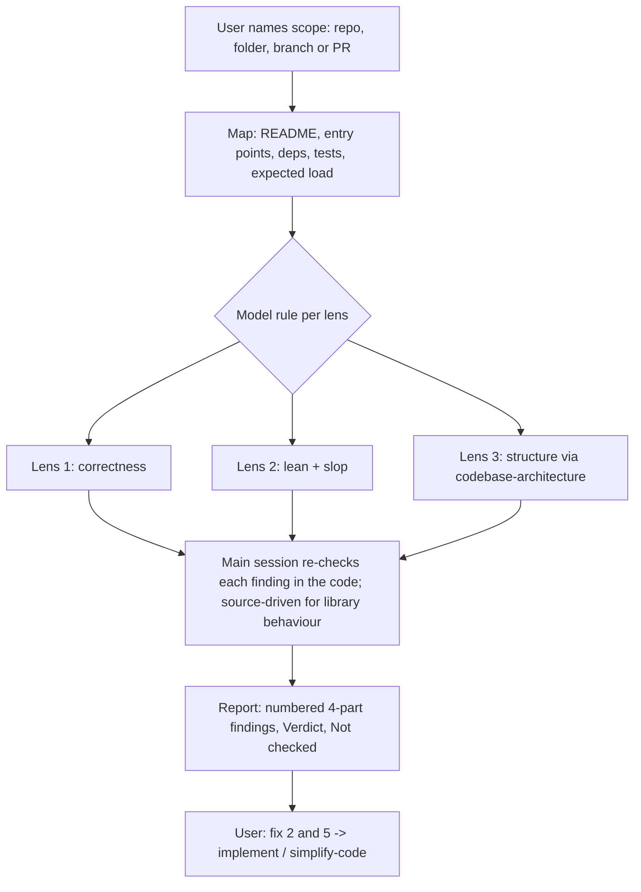

# code-audit

## Context

`review-code` answers one question about one diff: can this ship against
its spec? Nothing in `sde` audits a whole repo, a folder, or a large
AI-written PR for bugs, over-engineering and AI-code slop (patterns
agents tend to leave behind: swallowed errors, pass-through wrappers,
duplicate helpers, comments that repeat the code). `README.md:393-400`
says this gap is deliberate and points to ponytail's `ponytail-audit`
instead. The team wants it inside `sde`, so one plugin covers it, and
with the structural lens `codebase-architecture` already owns.

The check list adapts `ponytail-audit` and `ponytail-review`
(github.com/DietrichGebert/ponytail, `skills/`, MIT license, read
2026-11-02).

## Goals

1. `/sde:code-audit` audits a scope the user names: the whole repo, a
   folder, a branch, or a PR (number or link). Nothing named: the whole
   repo.
2. It fans out to 3 subagents, one per lens, then merges their findings
   in the main session:
   - **Lens 1, correctness:** bugs, security, data loss, scale, risky
     code with no test. Uses `engineering-standards` (Error handling,
     Security, Testing) and `review-code`'s Step 4 (caller impact) and
     Step 5 (resource and failure-path audit).
   - **Lens 2, lean and slop:** code that shouldn't exist or should be
     smaller, plus the AI-slop checklist. Uses `engineering-standards`
     (Necessity and simplicity, DRY, SOLID).
   - **Lens 3, structure:** calls `codebase-architecture` on the scope's
     main modules.
3. It picks each lens's model by a rule, before dispatch, and prints the
   choice and its reason (see Approach).
4. The main session re-checks every subagent finding against the code
   before it goes in the report. A finding that depends on a library's
   exact behaviour is checked with `source-driven` first.
5. The report gives each finding in four parts (What this is / Problem /
   Fix / If we skip it), numbered, grouped Must fix / Should fix / Nice
   to have, ending with `Verdict:` and `Not checked:`.
6. It changes no file. The user picks findings ("fix 2 and 5"), which go
   to `implement` (behaviour changes) or `simplify-code` (same
   behaviour, cleaner code).

## Non-Goals

- Applying fixes — `implement` and `simplify-code` already do it, with TDD and review.
- A spec check or a READY / NEEDS FIXES verdict — that is `review-code`'s job; two gates on one PR would disagree.
- `review-code` calling `code-audit`, or the reverse — each stays usable alone; the user runs both when they want both.
- ponytail-debt, ponytail-gain, ponytail-help — we don't use the `shortcut:` comment convention, and the other two are display cards.
- Writing the report to a file by default — chat is enough for one engineer; it writes `docs/audits/YYYY-MM-DD-<scope>.md` only when asked.
- Fan-out by folder — the lens split works for a PR and a repo alike; folder fan-out waits for a dry run that shows one lens missing things on a big repo.
- Escalating a lens to opus after a failure — an audit has no pass/fail check to trigger a retry.
- `doubt-check` on each finding — the main session already re-checks findings it didn't write; doubt-check adds an agent per finding and is still draft.
- Plugin agent files (`agents/*.md`) — a fixed `model:` frontmatter can't follow a rule decided at run time.

## Assumptions

ASSUMPTIONS I'M MAKING:
- Scale: one engineer runs it by hand on one repo or PR, repos up to ~50k lines. Bigger repos: it goes deep where a mistake costs most and lists what it didn't read. Lifetime: long-lived.
- At most 20 findings per report; if smaller ones were left out, it says how many.
- The lens model rule is written into `code-audit` itself, so it works whether or not PR #10 (which adds the same rule to `plan-from-spec`) merges first.
- On OpenCode, which can't pick a model per subagent call, it says so once and runs every lens on the session model.
- Bucket: `engineering`, a supporting skill, not part of the spine. Status `draft`, listed in `docs/in-progress.md`, with no `docs/engineering/` page and no README skill listing until the dry run passes.
- The slop checklist lists only what `engineering-standards` doesn't already say, so no rule lives in two places.

## Boundaries

- Always: name the scope and the expected load assumed; give every finding a concrete case (this input leads to this wrong result); grep the whole tree before calling code unused; print each lens's model and reason.
- Ask first: writing the report to a file; auditing past 20 findings.
- Never: edit, create or delete a source file; commit; give a ship verdict; report a finding the main session couldn't confirm in the code.

## Approach

One skill, `skills/code-audit/SKILL.md`, plus
`references/slop-checklist.md`. The three lens briefs live in `SKILL.md`;
if that pushes it past ~200 lines, they move to `references/lenses.md`.
Rejected: a suite of 3 lens skills plus a runner (4 skills of upkeep for
one job, and no Goal calls a lens alone), and plugin agent files (see
Non-Goals).



**Scope.** A PR or branch: the diff plus the code it touches (callers of
every changed function, the functions it calls, their tests). A repo or
folder: the main flows end to end, deepest where a mistake costs most.

**Model rule.** Decided in the Map step, before any subagent starts:

| The scope contains | Lens on `opus` |
|---|---|
| auth, money, data writes or migrations, concurrency (locks, jobs, shared state) | Lens 1 |
| an interface imported by 2+ services or packages | Lens 3 |
| none of the above | none: every lens on the session model |

Lens 2 always runs on the session model. The report opens with one line
per lens, e.g. `Lens 1: opus (scope has payment writes in billing/)`.
Worked example: on a sonnet session, a PR touching `auth/session.py` and
3 UI files runs Lens 1 on opus and Lenses 2-3 on sonnet. On an opus
session, nothing changes.

**Finding shape** (from `ponytail-audit`):

```markdown
2. **Orders land on the wrong day** (`billing/close_day.py:L40-52`)
   - **What this is:** At midnight this job bills all orders of that day.
   - **Problem:** It takes "today" from the server clock in UTC, so an order at 00:30 in Berlin bills a day early.
   - **Fix:** `datetime.now(ZoneInfo("Europe/Berlin")).date()`. One line.
   - **If we skip it:** Late orders show the wrong date; accounting fixes them by hand.
```

## Testing Seams

- **Eval harness (`claude plugin eval`), on a scaffold repo with planted problems.** Catches: the skill firing, the 3 Agent calls and their models, the 4-part shape, missed or invented findings, any file edit. Misses: whether findings are useful on real code.
- **Dry run on the user's other repo.** Catches: noise and wrong findings on real code. Misses: nothing automatic; it's one engineer's judgement.
- **`scripts/validate.py` and `rg`.** Catch: frontmatter, status line, README and in-progress wiring. Miss: behaviour.

## Success Criteria & Evals

- **SC-1:** The skill passes the repo's validator. Check: `python3 scripts/validate.py` → `All checks passed`.
- **SC-2:** On a scaffold repo planted with (a) an `except: pass` around a database write, (b) an interface with one implementation that only passes calls through, (c) a lower-layer module importing a higher one, (d) a decoy function that looks unused but is called by its name as a string, and (e) a call passing a keyword argument the library does not have (`json.dumps(obj, sort=True)`; the real name is `sort_keys`) on a path no test runs, the audit reports (a) under Must fix, (b), (c) and (e) as findings, and does not report (d) as dead code. Every finding has all four parts. Check: `claude plugin eval . --no-publish --model sonnet --case code-audit-repo --scaffold --allow-tools Write Edit Bash` → the harness marks the case passed (≥ 67% of runs pass; a mean score of 0.67 isn't enough).
- **SC-3:** In the SC-2 run, the trace shows 3 Agent calls, Lens 1's with `"model": "opus"` (the scope has a data write) and Lens 2's without it, and the report opens with each lens's model and reason. Check: the `lens-1-on-opus` and `lens-models-printed` graders in `code-audit-repo` pass.
- **SC-4:** On a scaffold git repo whose branch changes a function's return type, breaking a caller *outside* the diff, the audit reports the broken caller, and the report has no READY / NEEDS FIXES verdict and no spec-compliance section. Check: `claude plugin eval . --no-publish --model sonnet --case code-audit-pr --scaffold --allow-tools Write Edit Bash` → the harness marks the case passed (≥ 67% of runs pass).
- **SC-5:** Neither eval run edits a file: the trace has no Edit or Write call and no Bash command that changes a file (redirection into a file, `rm`, `mv`, `sed -i`, `git commit`). The harness grades the trace; it can't run `git status` in the scaffold itself. Check: the trace grader in both cases (`three-lenses-read-only` in `code-audit-repo`) passes.
- **SC-6:** The README no longer says the audit is left to ponytail, and credits it with its license. Check: `rg -c "What isn't\s*$" README.md` → no match, and `rg -c "code-audit.*ponytail|ponytail.*code-audit" README.md` → ≥ 1, and `rg -c "ponytail.*MIT|MIT.*ponytail" README.md` → ≥ 1. (Today: the first matches line 396, the other two match nothing.)
- **SC-7:** `code-audit` is tracked as draft and not promoted yet. Check: `rg -c "code-audit" docs/in-progress.md` → ≥ 1, and `test ! -e docs/engineering/code-audit.md && echo ok` → `ok`.
- **SC-8:** `SKILL.md` stays scannable. Check: `wc -l < skills/code-audit/SKILL.md` → ≤ 200.
- **SC-9:** On the user's other repo, a dry run produces ≥ 3 findings and the user marks ≥ 2 of every 3 as `real`, recorded in a `## Dry run` section of this spec as one line per finding (`- Finding N: real|wrong|noise — <why>`). Check: `rg -c '^- Finding [0-9]+: real' docs/specs/2026-11-02-code-audit.md` divided by `rg -c '^- Finding [0-9]+:' docs/specs/2026-11-02-code-audit.md` → ≥ 0.67, with the second count ≥ 3.

## Open Questions

- The eval runs (SC-2 to SC-5) can't sign in on this host, the same blocker as PR #10's evals: the eval child gets `401 Authentication Error, No api key passed in` from the Bedrock gateway (`evals/results/2026-10-23T15-06-58-712Z/aggregate-result.json`). Decided 2026-11-02: the user runs them on another machine where `claude plugin eval` can sign in (first run 2026-11-03, below).
- Eval run 2026-11-03 (second machine, macOS, Claude Code 2.1.314, head `a7eabdd`; PR #12 comment): SC-2 to SC-5 **run, not met**. `code-audit-repo` 0.17 over 3 runs (0.40 on a 4th), `code-audit-pr` 0.17; baseline 0.00; the skill fired in every run. Causes: the lenses ran inline in all 7 runs (no Agent call, so no opus pin); Should fix and Nice to have findings dropped parts of the four-part shape; sandboxed `git` blocked by the macOS Xcode shim (exit 72; `python3` warns but runs).
- Eval re-run 2026-11-03 (same machine, head `9f1d1a1`, `code-audit-repo` only, 3 runs; PR #12 review): scores 1.00, 0.40, 0.60 (mean 0.67), 1 of 3 runs passed, so the harness failed the case. The fan-out ran in 1 of 3 runs; run 3 skipped it because the eval child's Agent tool says to spawn subagents only when the user asks (step 4 now says running the skill is that request). `planted-problems-found` passed 3 of 3. The `tool: Agent` grader matches in the eval child (run 1: `Agent called 1x`), though its tool list prints `Task`. `code-audit-pr` (SC-4) still unrun: it needs a host with a non-shim `git`.
- Dry run (SC-9) repo: a private internal repo of the user's team (not named here, because this repo is public). The user picks the scope inside it (whole repo, a folder, or a PR) at dry-run time.

## Dry run

2026-11-02, a private internal repo of the user's team: a web app plus several tool servers. Not named here, because this repo is public; the detailed record is kept outside it. Whole repo: 15,777 of 109,562 code lines read in depth (7 of about 15 parts). Lens 1 and Lens 3 on opus, Lens 2 on the session model; `git status --porcelain` empty before and after. The user marked all 20 findings real. The main session's own re-check had flagged 2 of them as partly or probably wrong; the user's marks stand.

- Finding 1: real — access control (file download)
- Finding 2: real — access control (credential exposure)
- Finding 3: real — committed secret (placeholder; risk depends on deploy)
- Finding 4: real — concurrency (lock file)
- Finding 5: real — data deletion ignores a guard
- Finding 6: real — trust boundary (caller-supplied role)
- Finding 7: real — access control (permission check skipped)
- Finding 8: real — authentication
- Finding 9: real — committed secret
- Finding 10: real — access control (ownership check missing)
- Finding 11: real — access control (empty list means all)
- Finding 12: real — concurrency (shared file)
- Finding 13: real — performance (blocking call in async handler)
- Finding 14: real — error handling (failure hidden as empty result)
- Finding 15: real — concurrency (cache and connect)
- Finding 16: real — data overwrite ignores a guard
- Finding 17: real — duplication (near-copy modules)
- Finding 18: real — duplication (small helpers)
- Finding 19: real — missing tests
- Finding 20: real — cleanup (dependencies, unused code)

Changes from this run: the 20-finding cap is gone (it cut 10 leads, one a possible path traversal); unchecked leads go on a `Leads:` line; a big scope is split into more audits; lens briefs never print a secret's value.
