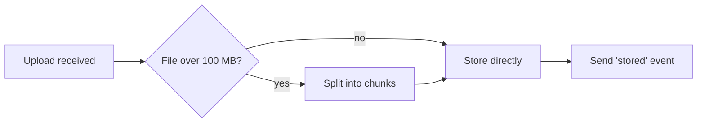
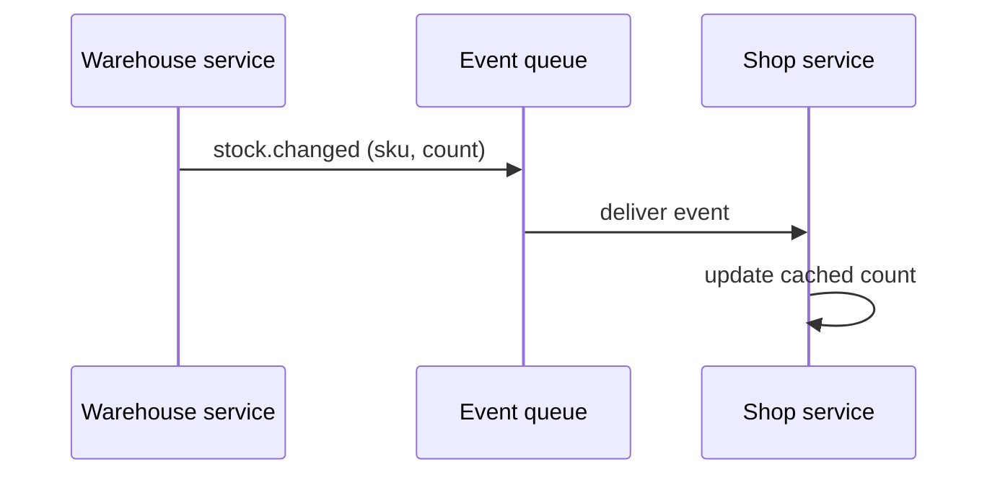
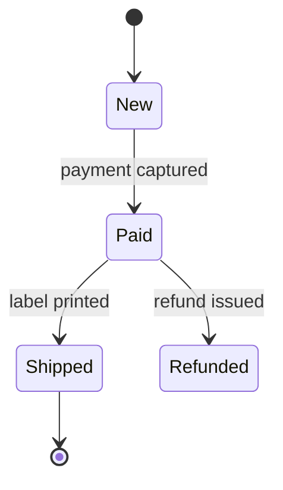

# Patterns: word swaps, diagram templates, before/after

## Word swaps

Swap the left word for the right one, or cut it. When the right-hand
column says "say what", replace the word with the specific fact it was
standing in for.

| Instead of | Write |
|---|---|
| leverage, utilize | use |
| ensure | check, make sure, or say how ("the test fails if…") |
| facilitate, enable | help, let |
| robust | say what it survives: "retries 3 times on timeout" |
| seamless, seamlessly | cut, or say what the user no longer has to do |
| comprehensive | cut, or say what's covered |
| scalable | say the number: "handles 10k requests/min" |
| performant | say the number: "p95 under 200 ms" |
| crucial, critical, vital, essential | say the consequence of getting it wrong |
| delve into, dive into | look at |
| in order to | to |
| prior to | before |
| a number of | some, or the number |
| at this point in time | now |
| it is worth noting that, importantly, notably | cut |
| holistic, synergy, paradigm, landscape | cut, or say the specific thing |
| streamline | simplify, or say what step is removed |
| empower | let |
| going forward | from now on, or cut |

## Sentence patterns to avoid

| Pattern | Example | Plain version |
|---|---|---|
| "Not just X, but Y" | "This isn't just a cache, it's a consistency layer." | "The cache also keeps the two services in sync." |
| Three-adjective list | "fast, reliable, and scalable" | Name the one property that matters, with its number |
| Dash-wrapped aside | "The worker — which runs every 5 min — retries…" | "The worker runs every 5 min. It retries…" |
| Hedge stack | "This may potentially cause issues." | "This fails when the file is over 2 GB." |
| Passive with no actor | "The token is validated." | "The gateway validates the token." |
| Echo opener | "Great question! To answer whether X…" | Answer X |
| Summary closer | "In summary, this approach ensures…" | Cut. The first line already said it |

## Diagram templates

### Flowchart (Mermaid): a flow or a decision



### Sequence (Mermaid): parts talking over time



### State (Mermaid): something moving between states



### ASCII: the same shapes for chat and terminal

```
Upload ──> over 100 MB? ──yes──> split into chunks ──┐
                │                                     v
                └──no─────────────────────────> store ──> 'stored' event
```

```
Before                        After
┌──────────┐                  ┌──────────┐    ┌─────────┐
│ Shop     │ polls every 60s  │ Shop     │<───│ Event   │<── Warehouse
│ service  │──> Warehouse     │ service  │    │ queue   │    publishes
└──────────┘                  └──────────┘    └─────────┘
```

## Before / after

### Spec: Approach section

Before:

> This feature will leverage a robust, event-driven architecture to
> seamlessly facilitate real-time synchronization of inventory data across
> distributed services, ensuring consistency.

After:

> When stock changes in the warehouse service, the shop must show the new
> count within 5 seconds (SC-1). The warehouse service publishes a
> `stock.changed` event. The shop service listens for it and updates its
> cached count. "Event-driven" here means the shop is told about changes
> instead of asking for them every 60 seconds, as it does today.
>
> *(followed by the sequence diagram above)*

Every precise detail survived: the 5-second limit, the event name, the
criterion ID, and the old 60-second polling interval. The jargon that
carried no information did not.

### Plan step

Before:

> ### 3. Implement resilience layer for upload pipeline

After:

> ### 3. Retry failed chunk uploads, up to 3 times
> - Satisfies: SC-2
> - Verification: `pytest tests/test_upload.py -k retry` → 4 passed

### Interview question

Before:

> Q: To ensure robust handling of the export functionality at scale,
> should we leverage server-side pagination, or would a streaming approach
> better facilitate large datasets going forward?
> GUESS: Streaming is likely the more scalable and future-proof option.

After:

> Q: For big reports (over 100k rows), should export stream the file while
> it's built, or build the whole file first and then send it?
> GUESS: Stream it, because building first holds the whole file in memory,
> and at 100k+ rows that is the likely cause of the timeout you saw.
